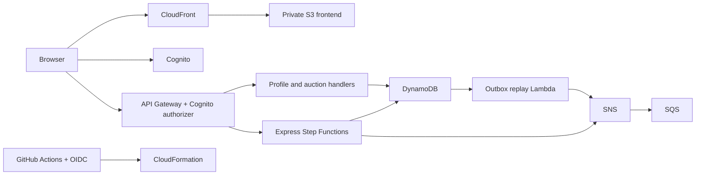

# AWS Serverless Auction Platform

[](https://github.com/fez22001/aws-serverless-auction-platform/actions/workflows/auction-ci.yml)

An invitation-only auction demonstration built with React, Amazon Cognito, API Gateway, Lambda, Step Functions, DynamoDB, SNS/SQS and CloudFront.

**Demo:** https://d2a68mjwt4vq2s.cloudfront.net · An invited account is required. All balances, bids and items are fictional; no payments are processed.

## What it demonstrates

- Cognito authorization-code sign-in with PKCE, short-lived tokens and no browser client secret.
- Every API operation requires a valid token for this app client. Profiles and bids bind to the signed-in Cognito subject; profile creation grants 1,000 fictional credits once.
- Only the auction creator may close it. A DynamoDB transaction records the close and debits the winner atomically; retries do not charge twice.
- Optimistic concurrency, durable idempotency receipts, and an outbox with scheduled retry for at-least-once notifications.
- Private S3 origin behind CloudFront OAC, access/error monitoring, point-in-time recovery and cost alerts.
- Public pull requests run offline CI without AWS credentials. Manual deployments use a protected GitHub environment and AWS OIDC, immutable releases and a reviewed CloudFormation change-set digest.



## Run locally

Install Node.js 24 (see `.nvmrc`) and Python 3.13, then:

```bash
bash scripts/setup-local.sh
python3 scripts/run_local.py
```

Open http://127.0.0.1:5173. The local simulator uses synthetic, in-memory data and resets on restart. It deliberately supports selecting synthetic users without cloud sign-in; it binds only to loopback. It is not a production authentication service.

```bash
.venv/bin/python -m pytest
bash scripts/npm.sh run lint
bash scripts/npm.sh run build
python3 scripts/build_infra.py --check
```

Generated workflow and CloudFormation files are checked in for review. Modify `scripts/build_workflows.py` or `scripts/build_infra.py`, then regenerate and run the checks.

## Operate the cloud demo

See [Deployment](docs/DEPLOYMENT.md), [Authentication](docs/AUTHENTICATION.md), and [Security and limitations](SECURITY.md). Configuration examples contain no credentials. Keep account-specific configuration in ignored `infra/deploy.local.json` and use a short-lived AWS login.

The original React teaching starter is by Jonathan Clark; its MIT license is preserved in [ReactAuction/LICENSE](ReactAuction/LICENSE). This repository is a curated continuation of a course project. Historical assignments, the original private Git history and local recovery records are not published here.
